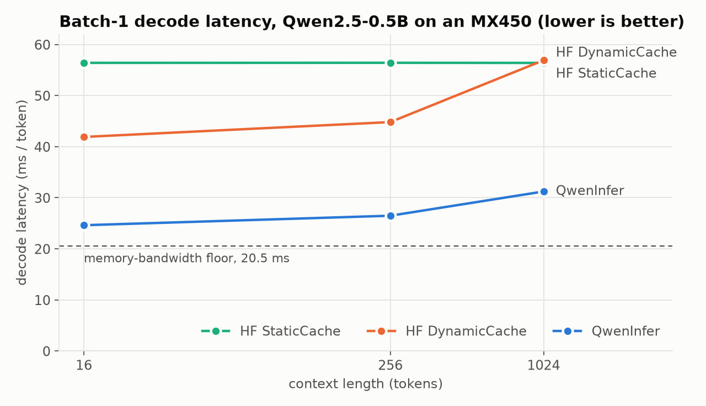
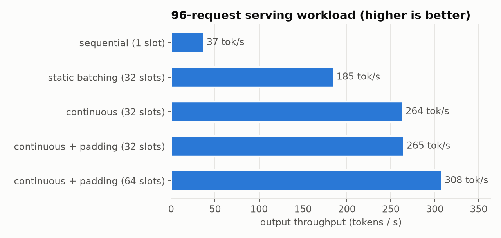
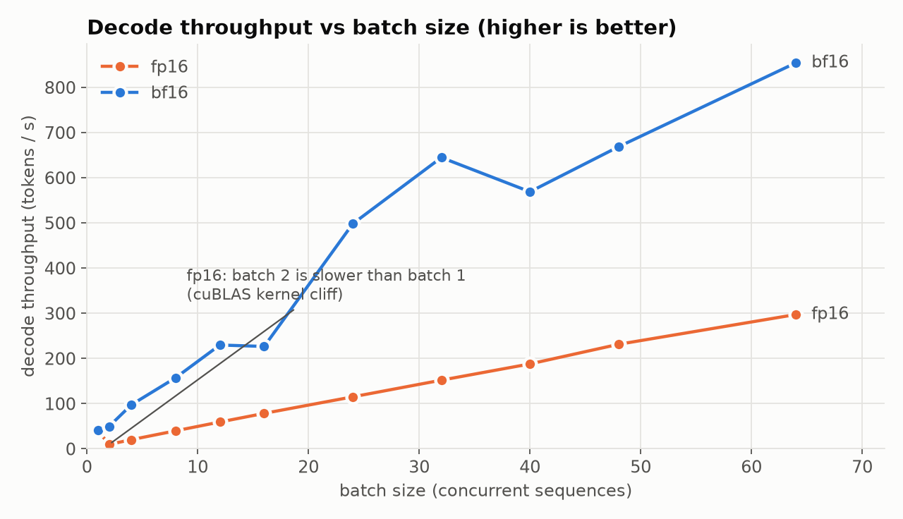

# QwenInfer

**A from-scratch LLM inference engine for memory-constrained GPUs.**

QwenInfer runs Qwen2.5-0.5B on a 2 GB laptop GPU (NVIDIA MX450) with a forward
pass, KV cache and continuous-batching scheduler written from scratch in PyTorch.
It is verified against HuggingFace `transformers` by exact logit parity, decodes
**1.7 to 1.8x faster than HuggingFace** on the same hardware at **83% of the
GPU's memory-bandwidth limit**, and serves concurrent requests at up to
**8.3x the throughput** of one-at-a-time generation.



## Highlights

- **Complete Qwen2 implementation**: RMSNorm, rotary position embeddings,
  grouped-query attention, SwiGLU, tied embeddings and a KV cache, with no model
  code from `transformers`.
- **Verified, not eyeballed.** Per-layer hidden states, final logits and greedy
  decoding match HuggingFace. Across 8 prompts, QwenInfer's fp16 logits deviate
  from the fp32 ground truth about half as much as HuggingFace's own fp16 path,
  because the residual stream is kept in fp32.
- **Profiling-driven 1.7x decode speedup** from one change in weight layout
  ([the main finding](#the-main-finding-a-kernel-built-for-hardware-this-gpu-does-not-have)).
- **A KV cache that stays flat as context grows**, where HuggingFace's two caches
  each fail in a different way.
- **Continuous batching**: 264 tok/s on a 96-request workload versus 37 tok/s
  sequentially and 185 tok/s with static batching.

## The main finding: a kernel built for hardware this GPU does not have

Batch-1 decode is memory-bound: every token requires reading all 942 MiB of
weights. At the measured 48.2 GB/s that sets a floor of **20.5 ms/token**. The
first working version took 42.3 ms, so roughly half the time was going somewhere
other than physics.

Profiling one decode step showed **32.5 of 40.8 ms of GPU time** in a single
kernel family, `cutlass_70_wmma_tensorop_f16_s161616`: a tensor-core kernel that
computes in 16x16x16 tiles. During decode each projection multiplies **one row**
(one token), so 15/16 of every tile is padding. And the MX450's TU117 die ships
without tensor cores.

A one-row matmul is a GEMV. Benchmarking mathematically identical formulations of
one projection ([`scripts/gemv_layout.py`](scripts/gemv_layout.py)):

```
F.linear(x, W)     weight stored (out, in), as nn.Linear does    16.6 GB/s
x @ W_t            weight stored (in, out)                       43.9 GB/s  (91% of peak)
```

Same math, same bytes, 2.6x the bandwidth: the transposed layout gets coalesced
reads and is dispatched to a GEMV kernel. QwenInfer therefore **repacks weights
once at load time**: projections transposed, Q/K/V fused into one matrix, gate/up
fused into one. That removes 72 kernel launches per token, changes no outputs (all
parity tests run through the repacked path), and took decode from 42.3 to
24.6 ms/token.

```
                    decode latency, ms/token (lower is better)
context   QwenInfer   HF DynamicCache   HF StaticCache   speedup vs best HF
   16       24.62          41.90             56.40            1.70x
  256       26.48          44.81             56.42            1.69x
 1024       31.22          56.91             56.39            1.81x
```

Prefill (time to first token) also improved slightly rather than regressing:

```
prompt tokens       64       256       512      1024
QwenInfer        155 ms    610 ms   1269 ms   2793 ms
HuggingFace      164 ms    666 ms   1281 ms   2835 ms
```

## The KV cache

HuggingFace's two caches fail in opposite directions:

| cache | behaviour | measured cost |
|---|---|---|
| `DynamicCache` | grows with `torch.cat` each step | +15 ms/step from 16 to 1024 tokens: allocator churn, versus 0.26 ms of actual KV bandwidth |
| `StaticCache` | preallocated to max length | flat ~56.4 ms: always attends over the whole reserved window |
| **QwenInfer** | preallocated once, attention reads a view sliced to the live length | neither cost |

The attention mask is derived from **absolute positions** (key `j` is visible to
the query at position `p` iff `j <= p`) rather than tensor shapes. That one rule
covers causal prefill, decode with no special case, and batches of sequences with
different lengths. The last is what makes batching work, and it is tested
directly.

## Serving: continuous batching

Decode is memory-bound, so a batch of B sequences reads the weights once and
produces B tokens. **Continuous batching** (iteration-level scheduling) re-forms
the batch every step: a finished request's slot goes to the next waiting request
immediately, instead of idling until the longest request in a static batch
finishes.

96 requests arriving together, prompts of 32 to 256 tokens, long-tailed output
lengths (median 75, max 256), each request generating exactly its assigned length
([`qweninfer/bench/serving.py`](qweninfer/bench/serving.py)):



```
mode                              throughput   mean time to first token   mean latency
sequential (1 slot)                37.3 tok/s          129.6 s               132.2 s
static batching (32 slots)        185.2 tok/s           19.9 s                27.4 s
continuous (32 slots)             263.7 tok/s           10.4 s                19.4 s
continuous + padding (64 slots)   308.2 tok/s            7.0 s                20.3 s
```

Engine design points:

- **Packed cache rows.** Live requests always occupy rows `0..n-1`, so each decode
  step reads one contiguous view. When a request finishes, the request in the last
  row moves into its place: one sequence's copy per finished request, instead of a
  gather over the whole live cache every step.
- **CPU-side bookkeeping.** Lengths, positions and slot assignment live in Python;
  the only device-to-host sync per step is reading back the new tokens.
- **Autotuned batch padding.** Decode step time is not monotonic in batch size on
  this GPU (bf16: 16 rows take 71 ms, 20 rows take 47 ms) because cuBLAS chooses
  kernels per shape. At startup the engine measures candidate sizes and pads each
  step to the fastest size at or above the active count, using spare cache rows
  that never hold requests. With 16 request slots this raises throughput from
  158 to 194 tok/s (+23%, [`padding.py`](qweninfer/bench/padding.py)); at 32 slots
  it has no effect, because 32 is already a fast size.

### Precision is a serving decision



In fp16 on this GPU, cuBLAS picks a poor kernel for 2 or more rows: **batch 2 is
slower than batch 1** (9 vs 40 tok/s). bf16 runs through cuBLAS's fp32 path
(Turing has no native bf16), at ~4x fp16's matmul throughput, and scales to
854 tok/s at batch 64. bf16 is less accurate (next section), so QwenInfer uses
fp16 for single-request generation and bf16 for batched serving. bf16 is also the
checkpoint's native format.

## Correctness

HuggingFace `transformers` is the oracle; no reference math is hand-written in
the tests.

| test | checks |
|---|---|
| `test_rmsnorm`, `test_rope`, `test_mlp` | each component against HF's own module |
| `test_hidden_states_per_layer` | all 24 layers; reports the first layer that diverges |
| `test_logit_parity` | final logits within 2e-3 (fp32) |
| `test_greedy_sequence_identical` | identical greedy tokens |
| `test_incremental_decode_matches_full_recompute` | cached decode == recomputing from scratch, every step |
| `test_generate_matches_hf_greedy` | end-to-end cached generation == HF |
| `test_ragged_batch_matches_individual` | different-length sequences batched == each alone |
| `test_engine_matches_individual_generation` | 6 requests through 2 slots == each generated alone |
| `test_engine_padding_does_not_change_outputs` | padded batches == unpadded |

### Numerical accuracy

Logit error against the fp32 ground truth over 8 fixed prompts, and how many
greedy 32-token continuations are identical to fp32
([`qweninfer/bench/accuracy.py`](qweninfer/bench/accuracy.py)):

```
config               mean err   max err   greedy = fp32
HF fp16               0.0166     0.686        8/8
QwenInfer fp16        0.0090     0.221        8/8
HF bf16               0.0911     1.820        3/8
QwenInfer bf16        0.0754     1.674        2/8
```

All 24 blocks add into the residual stream, so rounding it to 16 bits accumulates
error across the full depth. QwenInfer keeps the stream in fp32 (896 values per
token, effectively free: +0.1 ms/token) while matmuls run in 16 bits, which halves
the mean error. bf16 is less accurate in both implementations because every matmul
input is rounded to 8 significant bits; QwenInfer's bf16 error is below
HuggingFace's own.

## Hardware characterisation

Measured on the test machine (NVIDIA MX450, Turing sm_75, 14 SMs):

```
addressable VRAM     1681 MiB   (board is "2 GB"; ~367 MiB reserved)
memory bandwidth     48.2 GB/s  (56 GB/s theoretical, 64-bit GDDR5)
fp32 matmul          1.39 TFLOP/s
fp16 matmul          0.32 TFLOP/s   <- 4x slower than fp32
bf16 matmul          1.26 TFLOP/s
```

fp16 matmul being slower than fp32 is not an ALU limit: an elementwise fp16 FMA
runs at exactly 2x the fp32 rate. It is cuBLAS kernel selection on a die without
tensor cores, the same root cause as the main finding and the fp16 batching
cliff.

## Benchmark methodology

Laptop GPUs change clock speed under load, and naive timing on them is
unreliable: an un-warmed run measured 49 ms/token for a model that runs at
41.8 ms warm. Every benchmark here therefore:

- warms the GPU before timing and synchronises before reading the clock;
- interleaves conditions across rounds, so clock drift cannot pose as a trend;
- reports medians over repeated rounds (spread under 1%);
- runs separate implementations in separate processes, twice (A B C A B C), so
  cross-process drift would show up as disagreement between passes;
- compares configurations that differ in exactly one variable (an earlier padding
  comparison that also raised concurrency was discarded and re-run).

## Usage

```bash
uv sync --extra dev
# weights: Qwen/Qwen2.5-0.5B-Instruct -> weights/qwen2.5-0.5b-instruct/

.venv/bin/python scripts/chat.py                              # chat, streamed
.venv/bin/python -m pytest -q                                 # correctness suite
.venv/bin/python -m qweninfer.bench.decode_compare --driver   # decode vs HF
.venv/bin/python -m qweninfer.bench.prefill_compare           # prefill vs HF
.venv/bin/python -m qweninfer.bench.accuracy                  # error vs fp32
.venv/bin/python -m qweninfer.bench.batch_scaling             # throughput vs batch
.venv/bin/python -m qweninfer.bench.serving                   # serving workload
.venv/bin/python scripts/make_plots.py                        # README figures
```

```python
import torch
from qweninfer.models.qwen2 import Qwen2
from qweninfer.engine.generate import generate
from qweninfer.engine.engine import Engine, Request, autotune_padding

model = Qwen2.from_pretrained("weights/qwen2.5-0.5b-instruct")          # fp16, CUDA
tokens = generate(model, prompt_ids, max_new_tokens=100)

server = Qwen2.from_pretrained("weights/qwen2.5-0.5b-instruct", dtype=torch.bfloat16)
pad_to, _ = autotune_padding(server, max_slots=32)
engine = Engine(server, max_slots=32, max_len=512, pad_to=pad_to)
done = engine.run([Request(i, prompt, max_new_tokens=128) for i, prompt in enumerate(prompts)])
```

## Layout

```
qweninfer/
  models/config.py      model configuration
  models/qwen2.py       forward pass, weight loading and repacking
  engine/kv_cache.py    preallocated, length-sliced KV cache
  engine/generate.py    single-request prefill + decode loop
  engine/engine.py      continuous-batching scheduler, batch-padding autotuner
  bench/                benchmarks: decode, prefill, accuracy, batch scaling, serving
tests/                  parity, cache and engine correctness suites
scripts/                chat demo, hardware characterisation, plotting
results/                raw benchmark output (JSON) and figures
```

## Limitations and next steps

- **Attention cost still grows with context** (24.6 to 31.2 ms from 16 to 1024
  tokens). The two attention matmuls hit the same poor cuBLAS kernel selection,
  and PyTorch's `scaled_dot_product_attention` measured 44% *slower* on this GPU
  (its FlashAttention backend requires sm_80+). A custom Triton decode-attention
  kernel is the planned fix.
- **Paged KV cache: not built, by measurement.** Paging removes memory
  reservation waste, which matters when memory limits batch size. Here 64
  sequences of 512 tokens already fit and throughput is approaching the compute
  ceiling, so paging would add an estimated 20 to 30%, and in pure PyTorch it
  would reintroduce a whole-cache gather every step. It becomes worthwhile with a
  custom kernel on hardware where memory binds.
- **Prefill runs at the fp16 matmul ceiling** (~0.37 TFLOP/s). Computing prefill
  in bf16 or fp32, ~4x faster on this GPU, is a promising hardware-specific
  optimisation.
- **Kernel launch overhead** (hundreds of small kernels per decode step) could be
  removed with CUDA graphs.
- Results are from one GPU; the cuBLAS findings are specific to tensor-core-less
  Turing parts and should be re-measured on other hardware.
